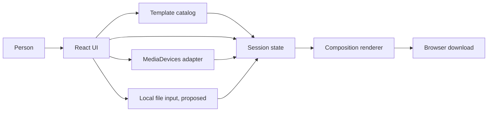

# Architecture

**Status: working draft.** Keep the first complete journey in the browser. Add remote services only when a feature requires them.

## Current repository

- `core/frontend` contains a Vite, React, TypeScript, and Tailwind starter. The frontend implements the local journey (choose, capture or upload, customize, review, export) entirely in the browser, with no backend calls.
- `core/backend`, `supabase`, and `test` are present as empty planning directories.
- Supabase and Vercel appear in the root README as planned technologies; neither is an integrated service here.

## Proposed first-release boundary

The browser owns the template selection, camera stream, any locally uploaded images, edits, rendering, and download. A session model tracks the selected template, captured or uploaded slots, and edit choices. Treat raw images as short-lived data; release camera tracks and object URLs when no longer needed. The upload path is proposed and still needs a release-scope decision.

**Implemented capture clip boundary:** A camera-filled slot may pair its still photo with a silent countdown clip. An uploaded slot has a still photo only, and a camera slot may also lack a clip if recording fails. One composition clip represents all slots in the finished template and is downloaded separately from the PNG. Recording, playback, composition, and download stay in the browser. Capture clip URLs are released with their slot on replacement, removal, or session reset. Browser compatibility beyond the local Edge pass remains **Open**.

**Planned extension:** Keep timer length with the selected template's capture state and camera source/orientation with each captured slot. One template has one timer setting for all of its camera captures; another template can choose separately. Camera direction is a session preference for the next shot, while the direction used for an existing shot stays with that slot. This lets front and back captures coexist without changing old photos or clips when the camera switches. Bundled font files are local application assets; store stable font IDs in edit settings and resolve them through one catalog for DOM preview, PNG canvas rendering, and composition video rendering. No photo or clip needs a server for these features.

Each capture clip mirrors its still. Replacing a slot replaces both its photo and any clip. A composition clip is generated only if at least one slot has motion. It runs the capture clips simultaneously for roughly three seconds, holds still-only slots static, and applies the same frame and edits as the PNG. The intended device scope includes current desktop Chrome, Edge, and Firefox, Android Chrome, and iPhone Safari; recording support and format must be verified on those targets before implementation is considered complete.

Capture clips have the same temporary lifetime as session photos and are released on replacement or reset. Composition video is generated locally on demand for download; it is not persisted in the session. PNG export remains independent of video export so a video failure cannot prevent the still download.

The composition video uses 720 px width at the template aspect ratio and about 30 fps. Browser capability detection chooses WebM where supported, then MP4, and uses the matching download extension. A claimed format may still fail during recording, so the photo-only and PNG-only recovery paths remain available.

## Boundaries

| Boundary | Responsibility | Guideline |
| --- | --- | --- |
| UI | Screens, controls, feedback, navigation | Present state and invoke actions; keep browser API details elsewhere. |
| Template catalog | Categories, stable IDs, slot count and geometry, default appearance | Supply a starting point independent from a person's later edits. |
| Session model | Valid steps and photo/edit data | Make invalid transitions visible and testable. |
| Camera adapter | Permission, stream lifecycle, device errors, capture | Isolate `MediaDevices` calls for focused tests and recovery. |
| Local file input | Validate and decode chosen images | Fill the same image slots as camera captures if upload is included. |
| Composition renderer | Combine images, template geometry, frame, effects, and text into pixels | Use the same input model for preview and export to reduce surprises. |
| Persistence/sharing | Future accounts, storage, and links | Introduce only after retention, access, and deletion rules are decided. |

## Data and privacy

The first release should process photos locally. Camera permission is browser-controlled and requested only at the capture step. Download is an explicit action. A shareable selection URL may contain only public category and template IDs, never image data. If a later feature sends an image to a server, the UI must make that action clear and the architecture must define who can access it, how long it stays, and how it is deleted.

Do not put service credentials in client code. Public client configuration, if later needed, belongs in environment variables with a checked-in example file; secrets belong in the service environment.

## Future service boundary

An optional account/gallery/sharing phase may add authentication, database metadata, and image storage. Keep the client-facing operations explicit, such as `saveStrip`, `listStrips`, and `deleteStrip`, so the browser-only flow does not depend on cloud availability. Storage permissions and share-link lifetime need a separate decision before implementation.

## Open decisions

- Whether the project needs a custom backend or only managed services for later features.
- Image representation during editing and maximum in-memory image size.
- Whether local draft persistence is useful, and its privacy implications.
- Cloud image retention, access control, link expiry, and deletion semantics.
