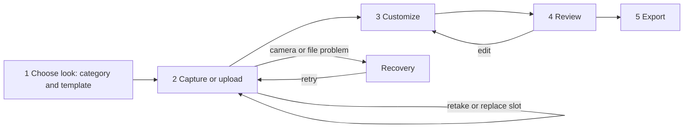

# UI and interaction direction

**Status: working draft.** The root URL opens a landing page where a person chooses a designed template or a blank layout before entering the five-step local journey through template selection, capture/upload, customization, review and PNG export (see [Frontend](FRONTEND.md#ui-shell-implemented)). Release scope remains provisional. Ephemora's approved application identity is inspired by ephemeral moments and the feeling of an old photo album. Photo output remains open to each person's creative choices.

## Main journey

**Authentication:** `/login` presents working email/password sign-in and Google OAuth. `/signup` collects first name, last name, username, email, and password; when email confirmation is enabled, it tells the person to check their inbox. Authenticated users can sign out from the app header. Sign-in is optional and does not gate the browser-local photo journey. Enterprise SSO remains **Open**.

## Screen responsibilities

**Planned controls:** On Capture or upload, show a clearly labeled 0 / 3 / 5 second timer choice before the first camera shot. Default to 3 seconds. Once that template has a camera capture, show the selected value as locked and explain that removing its camera captures permits a change. Keep the timer available when the camera is off, without asking for permission. Show Front / Back choice when camera capture is selected; switching between shots must stop the old stream, start the requested camera, and leave filled slots intact. If Back is unavailable, explain it and offer Front or upload. The live preview, saved still, capture clip, composition preview and downloads must agree on each slot's orientation. In Customize, provide separate font choices for the caption and the selected movable text item, with a sample of each of the three styles. The current look remains the initial choice.

| Screen | Main content | Essential states |
| --- | --- | --- |
| Choose look | Category tabs, template preview, photo count, progress, Continue | Initial, category changed, template selected, invalid URL selection, empty category |
| Capture or upload | Source choice, camera preview or local file input, filled slots | Permission request, ready, counting, capturing, file validation, denied, unavailable, error |
| Customize | Strip preview and editing controls | Default, edited, processing error |
| Review | Final preview and back/continue actions | Ready, rendering error |
| Export | Download action; later gallery and sharing actions if approved | Ready, exporting, export error, downloaded |

**Implemented capture clip behavior:** Camera capture pairs the still photo in a slot with a silent clip of the three-second countdown. Uploaded photos have no capture clip. Filled camera slots loop their capture clips together on the Capture screen. Review loops one roughly three-second composition clip with all captured slots moving simultaneously and still-only slots remaining still. The composition clip matches the PNG's frame, filter, caption, and stickers. Export offers that clip alongside the PNG only when at least one slot has motion. If clip recording fails but the photo succeeds, show that the slot has a photo without a clip and offer a retake. The download controls are separate actions.

**Further playback behavior:** Available motion autoplays and loops by default, with one visible Pause/Play control for all motion on the screen. When reduced motion is requested, show stills until Play is pressed. The capture clips mirror the camera view, and countdown numbers are not part of the saved video. If video export fails, the PNG remains downloadable and the person can retry video creation.

On a playback error, sustained stall, or high dropped-frame rate, fall back to stills in that preview and leave Play available to retry. This does not remove the capture clips or the video export option.

The root landing page sits before the five-step progress indicator. It has four sections: a hero, a three-step explanation, a template showcase, and a closing call to action. The top navigation and hero both offer **Choose a template** as the primary action; **Start with a blank page** is the secondary hero action. Template entry opens Choose look as step one; the blank option selects **Create Your Own** and the blank one-photo layout. The showcase includes an interactive, keyboard-operable preview cycling through three fixed sample compositions, with previous/next controls and direct slide buttons. These illustrative samples are separate from personal photos. The landing visual style retains Ephemora's warm ivory and mocha base, layering sage, dusty rose, and champagne across soft backgrounds, cards, and accents. Motion respects reduced-motion preferences. The five journey steps are **Choose look**, **Capture or upload**, **Customize**, **Review**, and **Export**. Preserve progress when moving backward within a session. Ask for camera permission in context, after the person chooses camera capture. Provide a direct retry action when the browser allows it; otherwise explain how to enable the camera in browser settings. Upload and later sharing remain scope decisions in [Features](FEATURES.md).

**Implemented progress treatment:** On wider screens, the five steps sit in equal-width tiles with the current step highlighted. On phones, all five numbered positions stay visible and a separate label names the current step. Completed steps can be used to move back; upcoming steps remain unavailable. A slim track shows how far the session has progressed.

## Choose look screen

When there is no explicit category or template in the URL, open **Create Your Own** with **Blank · 1 photo** selected. A valid category and template in the URL restore that selection.

- Heading: **A moment to remember.** Supporting copy: **Choose a look for your photos, then make it yours.**
- Top-level categories: **Photostrips**, **Single Photo**, **Frames**, **Create Your Own**. Use segmented tabs or another equally clear control; show which category is active.
- Show a large active template preview with previous/next controls, position such as `1 / 3`, template name, and a plain-language photo-count label. Neighbouring previews may be visible on desktop.
- Make the active template visually clear and provide **Continue with this** as the primary action. A selected template is a starting point; editor controls can change supported visual properties later.
- **Surprise me** can choose a template after its behavior is decided. It should still show the chosen template before advancing.
- **Create Your Own** should start from a blank composition while making its photo count and geometry clear before continuation.

The proposed URL is `/create?category=frames&template=minimal-white`. It identifies only the public selection. A refresh should restore the category and template when those IDs still exist; an unknown ID should fall back to a valid visible choice with clear feedback. This URL behavior can be implemented when navigation is added.

## Responsive layout

- **Mobile selection:** make category navigation horizontally scrollable, center one large template preview, and keep **Continue with this** easy to reach in a sticky bottom area.
- **Desktop selection:** show the active template prominently with neighboring previews at 1024 px and wider, and clear previous/next controls. Below that width, show only the active preview. Each preview fits its available column without changing its aspect ratio. Pagination dots have 44 px touch targets.
- **Mobile capture/editor:** prioritize the camera or strip preview; place the primary action within easy reach and keep editing controls in a compact panel.
- **Phone Customize (implemented):** below the `md` breakpoint (768 px) the strip preview is pinned to the top at about 38% of the viewport height (11 to 18 rem). Controls sit under it in three tabs: **Look** (frame and filter), **Caption**, and **Stickers and text**. One group shows at a time, so the preview stays visible while a sticker's size, rotation or color is changed. Selecting a sticker or text item on the preview opens the **Stickers and text** tab. The Continue bar is pinned to the bottom. Focus scrolling leaves room for both pinned areas, so a keyboard user's focused control never ends up underneath them. At `md` and wider, which includes a phone held sideways and portrait tablets, the preview sits beside all control groups and there are no tabs.
- **Step changes** open at the top of the page and move keyboard focus to the incoming heading after the previous screen exits.
- **Desktop capture/editor:** allow preview and controls to sit side by side where space permits.
- Make previews adapt to available width without changing the composition's export aspect ratio.
- Check landscape orientation and small viewports before calling a screen complete.

## Visual foundations to explore

The shell uses an Ephemora wordmark and a small photo-frame mark. The header gives a short local-processing cue; the footer explains that photos stay in the browser during creation and that a download is needed to keep the finished image. A keyboard skip link goes directly to the main screen.

**Chosen brand direction:** the lighter vintage ivory canvas `#F8F2E8` is adapted from the original `#F3EBDD` palette; champagne `#B99B7B` supplies small decorative details; mocha `#776957` is used for secondary text and primary actions; dusty beige `#D9CBB9` defines borders; soft charcoal `#33302D` anchors high-contrast text. Sage mist `#A9A58F` is an optional quiet accent. Serif display typography, warm light, subtle grain and restrained album details set the mood. The grain belongs to the app shell and does not alter captured or exported photos. Browser-native serif and sans-serif stacks avoid a font download.

- Warm ivory UI surfaces with clear contrast for text and controls.
- Elegant serif headings, structured layouts, and subtle album details that keep attention on the photos.
- Style choices such as monochrome, pastel, and vintage belong to the photo customization tools; the application shell should support all of them.
- Consistent spacing and type scale, with readable labels before decorative typography.
- Motion can make the countdown and screen changes feel playful; respect reduced motion settings.

The chosen color and type tokens live in `core/frontend/src/index.css`. Spacing, radius and focus treatment can be refined after desktop and mobile visual review.

## Accessibility review for every screen

- Semantic buttons, labels, visible focus, and a logical keyboard order.
- Category controls and template navigation need keyboard access and an announced active selection; the carousel must not require dragging.
- **Implemented:** category, source and mobile editor tabs use Left/Right arrows and Home/End with one tab stop per list. Focusing a decoration opens its controls; Enter/Space selects it, arrows move it and Delete removes it.
- Text status for countdown, capture progress, and errors; do not rely on color or animation alone.
- Touch targets large enough for comfortable use and no hover-only essential action.
- Camera preview and final composition have appropriate accessible names or descriptions; decorative elements stay out of the accessibility tree.
- Check contrast and zoom behavior against the eventual design tokens.

## Open design questions

- Whether the current original frame mark needs refinement after visual review.
- Initial photo style presets and how users can mix their elements.
- Whether the implemented 18-template catalog is final (see [Features](FEATURES.md#first-release-template-catalog)). Each preview is the template drawn with its default frame and filter and empty slots.
- Whether Surprise me selects within the current category or all templates.
- Whether capture is automatic after countdown or initiated for each slot. The shell starts the countdown for each photo on request and moves to the next empty slot afterward.
- Whether the phone editing layout (below) needs more than three tabs once more editing tools exist. The current layout keeps the preview in view while any control is adjusted.

## Remaining visual review

Review the landing page and Choose look on desktop and mobile with the Ephemora palette, including an active Photostrips template, a Frames template, Create Your Own, an invalid or empty selection state, and the sticky mobile action. Then review Capture or upload with permission, ready, filled-slot, and recovery states.
