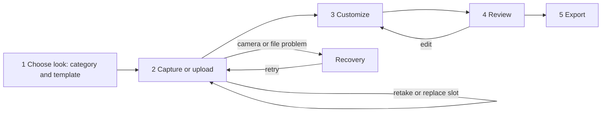

# UI and interaction direction

**Status: proposed.** The current app is a UI shell: header, five-step progress bar, a working Choose look screen with placeholder templates, and placeholder screens for the remaining steps (see [Frontend](FRONTEND.md#ui-shell-implemented)). The [design philosophy](../README.md#design-philosophy) sets a modern, sharp, light-themed interface and leaves the style of each person's photo output open to creative choice. [RollBooth's selection page](https://rollbooth.com/layout?tab=frames) is a reference for category-led browsing and a clear next action; Lumiora's visual language and assets should be its own.

## Main journey

## Screen responsibilities

| Screen | Main content | Essential states |
| --- | --- | --- |
| Choose look | Category tabs, template preview, photo count, progress, Continue | Initial, category changed, template selected, invalid URL selection, empty category |
| Capture or upload | Source choice, camera preview or local file input, filled slots | Permission request, ready, counting, capturing, file validation, denied, unavailable, error |
| Customize | Strip preview and editing controls | Default, edited, processing error |
| Review | Final preview and back/continue actions | Ready, rendering error |
| Export | Download action; later gallery and sharing actions if approved | Ready, exporting, export error, downloaded |

Use one clear primary action per screen and a persistent five-step progress indicator. Category choice and template browsing share the first screen; the progress steps are **Choose look**, **Capture or upload**, **Customize**, **Review**, and **Export**. Preserve progress when moving backward within a session. Ask for camera permission in context, after the person chooses camera capture. Provide a direct retry action when the browser allows it; otherwise explain how to enable the camera in browser settings. Upload and later sharing remain scope decisions in [Features](FEATURES.md).

## Choose look screen

- Heading: **Choose your look.** Supporting copy: **Find a starting point. Make it yours later.**
- Top-level categories: **Photostrips**, **Single Photo**, **Frames**, **Create Your Own**. Use segmented tabs or another equally clear control; show which category is active.
- Show a large active template preview with previous/next controls, position such as `1 / 3`, template name, and a plain-language photo-count label. Neighbouring previews may be visible on desktop.
- Make the active template visually clear and provide **Continue with this** as the primary action. A selected template is a starting point; editor controls can change supported visual properties later.
- **Surprise me** can choose a template after its behavior is decided. It should still show the chosen template before advancing.
- **Create Your Own** should start from a blank composition while making its photo count and geometry clear before continuation.

The proposed URL is `/create?category=frames&template=minimal-white`. It identifies only the public selection. A refresh should restore the category and template when those IDs still exist; an unknown ID should fall back to a valid visible choice with clear feedback. This URL behavior can be implemented when navigation is added.

## Responsive layout

- **Mobile selection:** make category navigation horizontally scrollable, center one large template preview, and keep **Continue with this** easy to reach in a sticky bottom area.
- **Desktop selection:** show the active template prominently with neighboring previews and clear previous/next controls.
- **Mobile capture/editor:** prioritize the camera or strip preview; place the primary action within easy reach and keep editing controls in a compact panel.
- **Desktop capture/editor:** allow preview and controls to sit side by side where space permits.
- Make previews adapt to available width without changing the composition's export aspect ratio.
- Check landscape orientation and small viewports before calling a screen complete.

## Visual foundations to explore

- Light, neutral UI surfaces with clear contrast for text and controls.
- Clean typography, structured layouts, and subtle details that keep attention on the photos.
- Style choices such as monochrome, pastel, and vintage belong to the photo customization tools; the application shell should support all of them.
- Consistent spacing and type scale, with readable labels before decorative typography.
- Motion can make the countdown and screen changes feel playful; respect reduced motion settings.

Create actual color, type, spacing, radius, and focus tokens after the first wireframes are reviewed. Record chosen tokens in the frontend styles rather than treating examples in this draft as fixed values. The shell's first-pass tokens in `core/frontend/src/index.css` are provisional.

## Accessibility review for every screen

- Semantic buttons, labels, visible focus, and a logical keyboard order.
- Category controls and template navigation need keyboard access and an announced active selection; the carousel must not require dragging.
- Text status for countdown, capture progress, and errors; do not rely on color or animation alone.
- Touch targets large enough for comfortable use and no hover-only essential action.
- Camera preview and final composition have appropriate accessible names or descriptions; decorative elements stay out of the accessibility tree.
- Check contrast and zoom behavior against the eventual design tokens.

## Open design questions

- Brand mark, exact UI colors, fonts, illustrations, and icon style.
- Initial photo style presets and how users can mix their elements.
- Whether the implemented 18-template catalog is final (see [Features](FEATURES.md#first-release-template-catalog)). Each preview is the template drawn with its default frame and filter and empty slots.
- Whether the five-step indicator includes a separate landing page or begins on Choose look; the current proposal and the shell begin on Choose look. RollBooth uses a landing page with a mode picker; Lumiora has not adopted one.
- Whether Surprise me selects within the current category or all templates.
- Whether capture is automatic after countdown or initiated for each slot. The shell starts the countdown for each photo on request and moves to the next empty slot afterward.
- How much editing fits on a phone without obscuring the strip preview. In the current Customize screen on a 390 px phone, the selected sticker's size, rotation and color controls sit below the preview, so the preview scrolls out of view while adjusting them. This is unresolved.

## Next design deliverable

Create high-fidelity **desktop and mobile mockups for Choose look**, including an active Photostrips template, a Frames template, Create Your Own, an invalid or empty selection state, and the sticky mobile action. Then design the Capture or upload screen with permission, ready, filled-slot, and recovery states. Use original Lumiora typography, colors, and preview assets.
